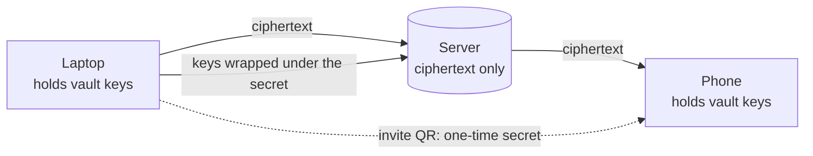

# obsync

obsync is end-to-end encrypted, self-hosted sync for [Obsidian](https://obsidian.md).
It has two parts: a small Go server that only ever stores ciphertext, and an
Obsidian plugin for desktop, iOS and Android. It is for people who want
their notes on all their devices, on a server they run, without that server
being able to read them.

What you get:

- **Conflicts handled for you.** Edits that do not overlap are merged. Edits
  that do are kept as a second copy next to the file. Nothing is ever
  silently overwritten.
- **Keys stay on your devices.** They are generated there and sealed by the
  OS keychain on desktop and the device keychain on phones and tablets.
- **Lost a device?** Remove it from another device. The vault keys rotate.
- **History.** Every version is kept for 90 days. You can restore one file
  or rewind the whole vault to a point in time.
- **Backups included.** The deploy kit snapshots the server nightly and can
  copy the snapshots off the host.
- **Large files sync as chunks**, so an edit uploads only what changed.

**Status.** Version 1.0.0. It adds chunked storage for large files, which
0.x clients cannot read, so every device in a vault must run 1.0 or newer.
Vaults made with 0.2 keep working after the server and all devices are
upgraded; nothing is migrated. The code is tested by an automated suite on
Linux, macOS and Windows with real Obsidian, and on a physical iPhone. It has
not yet been reviewed by a human security specialist, and it is young: keep a
backup of your vault while you get to know it.

## Quick start

You need a host with a public domain name (phones require a real HTTPS
certificate) and Obsidian on each device.

### 1. Run the server

**Route A: one binary with built-in HTTPS.** The server obtains a Let's
Encrypt certificate itself and listens on ports 443 and 80.

```sh
git clone https://github.com/instantcocoa/obsidian-sync
cd obsidian-sync/server
go build -o obsync ./cmd/obsync
sudo ./obsync serve --data /var/lib/obsync --acme-domain sync.example.com
```

`server/obsync.service` is a systemd unit that runs it as its own user.

**Route B: Docker behind Caddy.** For a host that already runs a compose
stack with a shared Caddy. From your own machine:

```sh
git clone https://github.com/instantcocoa/obsidian-sync
cd obsidian-sync
OBSYNC_SITE=sync.example.com server/deploy/deploy.sh myhost
```

The script copies the source to the host, builds the image, adds the
service to the stack, installs the Caddy site file and the nightly backup,
and waits for `https://sync.example.com/healthz`. Read
[server/README.md](server/README.md) first: it lists what the script
assumes about the host and how to adapt the two small config files.

To try it on your own machine only, no certificate needed:

```sh
cd server && go build -o obsync ./cmd/obsync
./obsync serve --data ./data --listen 127.0.0.1:8080 --public-url http://127.0.0.1:8080
```

### 2. Make a vault

On the server host:

```sh
sudo ./obsync vault create --data /var/lib/obsync
# Docker: docker compose exec obsync obsync vault create --data /data
```

It prints a one-time **create link** (`obsync://create#…`) and a QR code of
it. The link works once and lasts an hour (`--ttl 24h` for longer). There is
no admin password anywhere.

### 3. Install the plugin

In Obsidian, on every device:

1. Settings → Community plugins → Browse → install and enable **BRAT**.
2. Settings → BRAT → Add beta plugin → `instantcocoa/obsidian-sync`.
3. Enable **obsync**.

### 4. First device

Settings → obsync → **Join or create with a link** → paste the create link →
**Connect**. On a phone you can scan the QR code with the camera instead.
The vault keys are generated on this device and the folder is uploaded.

### 5. Every other device

On a device already in the vault: Settings → obsync → **Generate invite
link**. Scan the QR code with the new device's camera, or paste the link
into **Join or create with a link**. Each invite works once, for one hour.

### 6. Set a recovery passphrase

Settings → obsync → **Set recovery passphrase**. It is optional. It is also
the only way back in if you lose every device, so keep it with the vault id
shown on the same page.

## How it works

Each device encrypts every file, and its name, before anything leaves the
device. The server stores the ciphertext and an ordered log of changes. It
accepts a change to a file only if the device has seen the latest version,
so two devices can never overwrite each other unnoticed. The loser of that
race merges or keeps its version as a conflict copy.

The first device makes the vault keys. An invite link carries a one-time
secret; the vault keys travel to the new device wrapped under it. The server
relays the wrapped package and cannot open it.



Device tokens can only read. Every write also needs proof of holding the
vault key, so a stolen token alone cannot change or delete anything.

## Everyday use

Sync is automatic. On desktop the status bar shows `obsync ✓`. Phones have
no status bar; the state is under Settings → obsync.

Commands, from the command palette or the settings page:

| Command | What it does |
| --- | --- |
| Show conflicts | Lists conflict copies so you can open and resolve them |
| Show history for current file | Lets you save any earlier version |
| Manage devices | Lists devices; Remove revokes one and rotates the keys |
| Rotate vault keys | Makes new keys and re-encrypts, without removing anyone |
| Restore vault to a point in time | Rewinds the whole vault as new history, so it can be undone |
| Rebuild local state | Re-derives this device's bookkeeping by hashing files; keeps local edits |
| Reset this device to the server's copy | One-way: takes the server's version of everything; local differences go to `.trash/obsync-reset-…` |
| Protect keys | Chooses how the keys are stored here: OS keychain, device keychain, or a PIN |

What syncs, exclusions, and the conflict rules in detail are in
[plugin/README.md](plugin/README.md).

## Security model

**The server sees** ciphertext, sizes, timing, how many devices a vault has,
and each device's public key. **It cannot see** file contents, file names,
folder structure, or any key. An operator, or someone who steals the server
or its backups, gets nothing readable.

**A copied vault folder** contains the plugin's key file, but the keys in it
are sealed. On desktop the unsealing key is in the OS keychain. On phones
and tablets it is in the device keychain (Obsidian 1.11.4 or newer), or
behind a PIN you choose. The copy opens nothing.

**It does not protect against:**

- someone using your unlocked device;
- a malicious Obsidian plugin in the same vault, which can read your notes;
- a compromised release of obsync itself. Protect the account you install
  from, and consider turning off automatic plugin updates.

The full design is in [DESIGN.md](DESIGN.md). What a reviewer should check,
claim by claim, is in
[docs/SECURITY-REVIEW-GUIDE.md](docs/SECURITY-REVIEW-GUIDE.md).

## Operating the server

- **Backups.** The Docker deploy installs a nightly timer. It snapshots the
  database consistently while the server runs and keeps 14 days under
  `/var/backups/obsync/`. If `/etc/obsync/offsite.env` exists, each snapshot
  is also pushed with restic to any S3-compatible bucket
  (`server/deploy/offsite.env.example`). A backup is ciphertext, so it can
  sit anywhere.
- **Restore.** Stop the server, copy a snapshot over the data directory,
  start it. Devices notice the rewind and push back what the server forgot.
- **Upgrade.** Run `server/deploy/deploy.sh` again, or replace the binary
  and restart.
- **Admin page.** Optional. After you register a security key (a YubiKey,
  for example) with `obsync admin register`, `https://your-host/admin` can
  mint create links from a browser. To everyone else that page is a 404.
  The command line always works without it.

Commands, flags, the API and the backup and restore steps are in
[server/README.md](server/README.md).

## Coming from Self-hosted LiveSync

Your files are already on every device, so nothing moves between servers.
Turn LiveSync off in a vault, create an obsync vault from one device, and
join the others. The steps, the backups to take first, and how to go back
are in [docs/MIGRATION-FROM-LIVESYNC.md](docs/MIGRATION-FROM-LIVESYNC.md).

## Development

```sh
cd server && go test ./...     # the HTTP API end to end
cd plugin && npm install
npm test                       # unit tests and multi-device runs against the real server
npm run check                  # typecheck
npm run build                  # main.js
```

Warnings about esbuild install scripts during `npm install` are harmless.
To install a local build, copy `main.js`, `manifest.json` and `styles.css`
into `<vault>/.obsidian/plugins/obsync/` and restart Obsidian.

| Path | What is there |
| --- | --- |
| `server/` | The Go server: one static binary, SQLite plus a blob directory |
| `server/deploy/` | Dockerfile companions: compose service, Caddy site, deploy script, backup timer |
| `plugin/src/core/` | Platform-free TypeScript: crypto, sync engine, merge, transport |
| `plugin/src/obsidian/` | The Obsidian side: file access, settings, commands |
| `plugin/test/` | Tests, including runs inside real Obsidian and on iOS devices |
| `docs/` | Guides listed below |

## Documentation

| Document | Read it for |
| --- | --- |
| [DESIGN.md](DESIGN.md) | Why it exists and the full design: data model, protocol, crypto, conflict rules |
| [plugin/README.md](plugin/README.md) | Using the plugin: what syncs, conflicts, devices, keys |
| [server/README.md](server/README.md) | Running the server: flags, TLS, Docker, backups, the API |
| [docs/MIGRATION-FROM-LIVESYNC.md](docs/MIGRATION-FROM-LIVESYNC.md) | Moving a vault over from Self-hosted LiveSync |
| [docs/CONFLICT-RECOVERY-MATRIX.md](docs/CONFLICT-RECOVERY-MATRIX.md) | Every conflict and recovery case, its outcome, and the test that proves it |
| [docs/SECURITY-REVIEW-GUIDE.md](docs/SECURITY-REVIEW-GUIDE.md) | A brief for a human security reviewer |
| [docs/IOS-DEVICE-TESTING.md](docs/IOS-DEVICE-TESTING.md) | Running the test suite on a real iPhone and iPad |
| [docs/HANDOFF.md](docs/HANDOFF.md) | Project history and state, for whoever continues the work |
