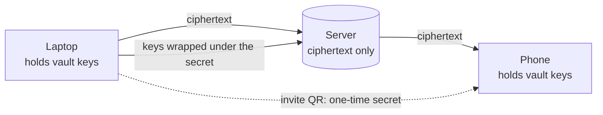

# obsync

obsync is end-to-end encrypted, self-hosted sync for [Obsidian](https://obsidian.md).
It has two parts: a small Go server that only ever stores ciphertext, and an
Obsidian plugin for desktop, iOS and Android. It is for people who want
their notes on all their devices, on a server they run, without that server
being able to read them.

What you get:

- **Conflicts handled for you.** Edits that do not overlap are merged. Edits
  that do are kept as a second copy next to the file. Nothing is ever
  silently overwritten.
- **Keys stay on your devices.** They are generated there and sealed by the
  OS keychain on desktop and the device keychain on phones and tablets.
- **Lost a device?** Remove it from another device. The vault keys rotate.
- **History.** Every version is kept for 90 days. You can restore one file
  or rewind the whole vault to a point in time.
- **Backups included.** The deploy kit snapshots the server nightly and can
  copy the snapshots off the host.
- **Large files sync as chunks**, so an edit uploads only what changed.

**Status.** Version 1.0.0. It adds chunked storage for large files, which
0.x clients cannot read, so every device in a vault must run 1.0 or newer.
Vaults made with 0.2 keep working after the server and all devices are
upgraded; nothing is migrated. The code is tested by an automated suite on
Linux, macOS and Windows with real Obsidian, and on a physical iPhone. It has
not yet been reviewed by a human security specialist, and it is young: keep a
backup of your vault while you get to know it.

## Setup guide

Follow the parts in order. Each step says what to do and what you should see
afterwards. If what you see differs, go to [Troubleshooting](#troubleshooting)
before moving on.

Short version for people who have done this before: run the server, run
`obsync vault create`, install the plugin through BRAT, paste the link on the
first device, scan an invite on the others.

### What you need before you start

- **A server that is always on**, reachable from the internet. Any small
  Linux VPS works (1 CPU, 512 MB of memory is plenty).
- **A domain name pointing at that server**, for example `sync.example.com`.
  Create an `A` record for it at your DNS provider with the server's IP
  address. Phones refuse to sync without a real HTTPS certificate, and a
  certificate needs a domain name.
- **Ports 80 and 443 open** on the server's firewall.
- **Obsidian** installed on each device you want to sync.
- About 20 minutes.

You do not need an account anywhere, a database, or a password for the
server. There is no admin password.

### Part 1: start the server

Do this once, on the server, over SSH.

**1. Install Go and git** (Debian or Ubuntu shown; any recent Go works):

```sh
sudo apt update && sudo apt install -y golang-go git
```

**2. Download and build obsync:**

```sh
git clone https://github.com/instantcocoa/obsidian-sync
cd obsidian-sync/server
go build -o obsync ./cmd/obsync
```

You should now have a file named `obsync` in this folder. `./obsync` with no
arguments prints a list of commands.

**3. Install it as a service** so it starts on boot and restarts if it
stops. Put your own domain in the first line, then paste the rest as is:

```sh
DOMAIN=sync.example.com
sudo cp obsync /usr/local/bin/obsync
sed "s/sync\.example\.com/$DOMAIN/g" obsync.service | sudo tee /etc/systemd/system/obsync.service >/dev/null
sudo systemctl daemon-reload
sudo systemctl enable --now obsync
```

The server fetches its own HTTPS certificate from Let's Encrypt the first
time something connects. Your notes will live under `/var/lib/obsync`,
encrypted.

**4. Check it is running.** From any computer:

```sh
curl https://sync.example.com/healthz
```

You should see `ok`. The first request can take ten seconds while the
certificate is issued.

Already run Docker with a Caddy reverse proxy? Use the kit in
[server/deploy](server/deploy) instead of steps 1 to 3;
[server/README.md](server/README.md) explains it.

Just trying it on your own computer, with no domain? Skip step 3 and run
this instead. Computers on the same machine can connect; phones cannot,
because there is no certificate.

```sh
./obsync serve --data ./data --listen 127.0.0.1:8080 --public-url http://127.0.0.1:8080
```

### Part 2: create a vault on the server

A "vault" on the server is an empty, locked box. The first device to open it
makes the keys.

On the server:

```sh
sudo obsync vault create --data /var/lib/obsync
```

It prints a line starting with `obsync://create#` and a QR code of the same
link. This is your **create link**. Keep the terminal open.

- The link works **once** and expires after **one hour**. Add `--ttl 24h` if
  you need longer. Run the command again any time for a fresh link.
- One link makes one vault. If you have two Obsidian vaults, run the command
  twice and use one link in each.

### Part 3: install the plugin

Do this in Obsidian on **every** device, in **each vault** you want synced.
Plugins are installed per vault.

1. Open the vault you want to sync.
2. Open **Settings** (the gear icon).
3. Go to **Community plugins**. If it says restricted mode is on, press
   **Turn on community plugins**.
4. Press **Browse**, search for **BRAT**, press **Install**, then **Enable**.
5. Close the browser. In Settings, scroll the left column down to **BRAT**.
6. Press **Add beta plugin**. Paste this and confirm:

   ```
   instantcocoa/obsidian-sync
   ```

7. Leave "Enable after installing" ticked.

You should now see **obsync** in the left column of Settings. If you use
another sync plugin in this vault (Self-hosted LiveSync, Remotely Save),
turn it off first. Two sync tools in one vault fight each other.

### Part 4: connect your first device

Use the device that has your notes, usually your computer.

1. In Obsidian: **Settings → obsync**.
2. Check **Device name**. It is how this device shows up on your other
   devices. Change it if you like.
3. Copy the create link from the server's terminal (the whole line starting
   with `obsync://create#`).
4. Paste it into **Join or create with a link** and press **Connect**.

What you should see: a notice that the vault was created, and on a computer
`obsync ✓` in the status bar at the bottom right once the upload finishes.
A few hundred notes take under a minute.

Your encryption keys were just made on this device. On a computer they are
locked with the operating system's keychain automatically. Nothing to do.

### Part 5: add your other devices

Repeat for each phone, tablet or second computer. The new device can start
with an empty vault or with a copy of the same notes; both work.

1. On the new device, do [Part 3](#part-3-install-the-plugin) in the vault
   you want to sync. **Leave that vault open.**
2. On the **first** device: **Settings → obsync → Generate invite link**. A
   QR code and a link appear.
3. **Phone or tablet:** open the Camera app, point it at the QR code, tap
   the Obsidian banner. **Computer:** copy the link, paste it into **Join or
   create with a link** on the new device, press **Connect**.
4. Obsidian asks "Join the vault on https://sync.example.com?" Press
   **Join**.

Each invite works for **one device** and expires after **one hour**. Make a
new one for each device.

What you should see: your notes appear on the new device. Phones have no
status bar, so tap the obsync icon in the ribbon menu (or run **obsync: Show
sync status**) to see the sync state; a problem also shows a notice. On the first device, **Manage devices** now lists the new one.

Files that were already identical on both devices are recognised without
downloading again. If a file differed, both versions are kept: the second
one gets "(conflict …)" in its name. Nothing is overwritten.

### Part 6: set a recovery passphrase

Optional, and strongly recommended. Without it, if you lose **every**
device, your notes on the server can never be decrypted by anyone, including
you.

1. On any connected device: **Settings → obsync → Set recovery passphrase**.
2. Choose four or more random words, or 20 or more characters.
3. Write down three things together, somewhere safe and not in the vault:
   the passphrase, the **Vault id** shown at the top of the obsync settings,
   and your server address.

To use it later on a new device: **Settings → obsync → Join with recovery
passphrase**.

### Part 7: check that it works

1. On device A, create a note called `sync test` and type a line.
2. Within a few seconds it appears on device B.
3. Edit it on B. The change appears on A.
4. Run the command **obsync: Show conflicts** (open the command palette and
   type "conflicts"). An empty list is what you want.

You are done. From here on there is nothing to press: edits sync as you
make them, and catch up automatically after a device has been offline.

### Troubleshooting

| What you see | What it means | What to do |
| --- | --- | --- |
| `curl` to `/healthz` fails or times out | The server is not reachable | Check the DNS record points at the server, ports 80 and 443 are open, and `sudo systemctl status obsync` says active. `sudo journalctl -u obsync -n 50` shows why it stopped. |
| An error that the link was used, has expired or is not valid | Create links last an hour and work once | Run `sudo obsync vault create --data /var/lib/obsync` again and use the new link. |
| "Unrecognized URI" or nothing happens when a link or QR opens Obsidian | obsync is not installed or not enabled in the vault that is open | Open the right vault, finish Part 3 there, try again. |
| obsync is missing from Settings | The plugin is not installed in **this** vault | Plugins are per vault. Do Part 3 in this vault. |
| "this device is already in a vault" | This Obsidian vault is already connected | Nothing to do, or **Settings → obsync → Advanced → Leave this vault** to connect it elsewhere. |
| A notice that some files "cannot sync" because of their name | The name contains `? * : < > " \| \` | Rename the file inside Obsidian. Those characters are not allowed on every platform, so obsync refuses them everywhere. |
| Files named "… (conflict device date).md" | The same file was changed in two places at once | Run **obsync: Show conflicts**. It lists each one with the lines that differ and buttons to keep the current file, keep the other version, or open both. |
| A phone never syncs | No HTTPS, or the plugin is not enabled | The server address must start with `https://` and have a real certificate. Check **Settings → obsync** for the status line. |
| A phone stops syncing in the background | iOS and Android pause apps that are not on screen | Open Obsidian; it catches up within seconds. |
| "keys changed on another device" then normal again | Another device rotated the keys | Nothing. It is informational. |
| One device looks wrong and the others are right | That device drifted | **Settings → obsync → Advanced → Reset this device to the server's copy**. Its differing files are moved to `.trash/obsync-reset-…`, not deleted. |
| Large files do not appear on one device | That device runs an older plugin | Update obsync on every device: **Settings → BRAT → Check for updates**. All devices of a vault need 1.0 or newer. |
| You lost a device | Its copy of the keys is out of your hands | On another device: **Manage devices → Remove**. The keys rotate and the lost device can read nothing new. |

### Common questions

**Do I need the YubiKey or the `/admin` page?** No. It is an optional way to
make create links from a browser instead of from SSH. See
[server/README.md](server/README.md).

**Can the server operator read my notes?** No. The server stores encrypted
data and never receives a key. That is also why a lost recovery passphrase
cannot be reset.

**Where are my keys?** On each device, in the plugin's folder inside the
vault, locked by the operating system's keychain on computers and by the
device keychain on phones and tablets.

**How do I update?** Plugin: **Settings → BRAT → Check for updates** on each
device. Server: `git pull`, build again, copy the binary to
`/usr/local/bin/obsync`, `sudo systemctl restart obsync`.

**How do I back up the server?** Copy `/var/lib/obsync` while the service is
stopped, or use the nightly backup kit in [server/deploy](server/deploy).
Every device also holds a full copy of your notes.

**How do I stop using it?** **Settings → obsync → Advanced → Leave this
vault** on each device. Your notes stay on every device as ordinary files.

## How it works

Each device encrypts every file, and its name, before anything leaves the
device. The server stores the ciphertext and an ordered log of changes. It
accepts a change to a file only if the device has seen the latest version,
so two devices can never overwrite each other unnoticed. The loser of that
race merges or keeps its version as a conflict copy.

The first device makes the vault keys. An invite link carries a one-time
secret; the vault keys travel to the new device wrapped under it. The server
relays the wrapped package and cannot open it.



Device tokens can only read. Every write also needs proof of holding the
vault key, so a stolen token alone cannot change or delete anything.

## Everyday use

Sync is automatic. On desktop the status bar shows `obsync ✓`. Phones have
no status bar; the state is under Settings → obsync.

Commands, from the command palette or the settings page:

| Command | What it does |
| --- | --- |
| Show conflicts | Lists conflict copies so you can open and resolve them |
| Show history for current file | Lets you save any earlier version |
| Manage devices | Lists devices; Remove revokes one and rotates the keys |
| Rotate vault keys | Makes new keys and re-encrypts, without removing anyone |
| Restore vault to a point in time | Rewinds the whole vault as new history, so it can be undone |
| Rebuild local state | Re-derives this device's bookkeeping by hashing files; keeps local edits |
| Reset this device to the server's copy | One-way: takes the server's version of everything; local differences go to `.trash/obsync-reset-…` |
| Protect keys | Chooses how the keys are stored here: OS keychain, device keychain, or a PIN |

What syncs, exclusions, and the conflict rules in detail are in
[plugin/README.md](plugin/README.md).

## Security model

**The server sees** ciphertext, sizes, timing, how many devices a vault has,
and each device's public key. **It cannot see** file contents, file names,
folder structure, or any key. An operator, or someone who steals the server
or its backups, gets nothing readable.

**A copied vault folder** contains the plugin's key file, but the keys in it
are sealed. On desktop the unsealing key is in the OS keychain. On phones
and tablets it is in the device keychain (Obsidian 1.11.4 or newer), or
behind a PIN you choose. The copy opens nothing.

**It does not protect against:**

- someone using your unlocked device;
- a malicious Obsidian plugin in the same vault, which can read your notes;
- a compromised release of obsync itself. Protect the account you install
  from, and consider turning off automatic plugin updates.

The full design is in [DESIGN.md](DESIGN.md). What a reviewer should check,
claim by claim, is in
[docs/SECURITY-REVIEW-GUIDE.md](docs/SECURITY-REVIEW-GUIDE.md).

## Operating the server

- **Backups.** The Docker deploy installs a nightly timer. It snapshots the
  database consistently while the server runs and keeps 14 days under
  `/var/backups/obsync/`. If `/etc/obsync/offsite.env` exists, each snapshot
  is also pushed with restic to any S3-compatible bucket
  (`server/deploy/offsite.env.example`). A backup is ciphertext, so it can
  sit anywhere.
- **Restore.** Stop the server, copy a snapshot over the data directory,
  start it. Devices notice the rewind and push back what the server forgot.
- **Upgrade.** Run `server/deploy/deploy.sh` again, or replace the binary
  and restart.
- **Admin page.** Optional. After you register a security key (a YubiKey,
  for example) with `obsync admin register`, `https://your-host/admin` can
  mint create links from a browser. To everyone else that page is a 404.
  The command line always works without it.

Commands, flags, the API and the backup and restore steps are in
[server/README.md](server/README.md).

## Coming from Self-hosted LiveSync

Your files are already on every device, so nothing moves between servers.
Turn LiveSync off in a vault, create an obsync vault from one device, and
join the others. The steps, the backups to take first, and how to go back
are in [docs/MIGRATION-FROM-LIVESYNC.md](docs/MIGRATION-FROM-LIVESYNC.md).

## Development

```sh
cd server && go test ./...     # the HTTP API end to end
cd plugin && npm install
npm test                       # unit tests and multi-device runs against the real server
npm run check                  # typecheck
npm run build                  # main.js
```

Warnings about esbuild install scripts during `npm install` are harmless.
To install a local build, copy `main.js`, `manifest.json` and `styles.css`
into `<vault>/.obsidian/plugins/obsync/` and restart Obsidian.

| Path | What is there |
| --- | --- |
| `server/` | The Go server: one static binary, SQLite plus a blob directory |
| `server/deploy/` | Dockerfile companions: compose service, Caddy site, deploy script, backup timer |
| `plugin/src/core/` | Platform-free TypeScript: crypto, sync engine, merge, transport |
| `plugin/src/obsidian/` | The Obsidian side: file access, settings, commands |
| `plugin/test/` | Tests, including runs inside real Obsidian and on iOS devices |
| `docs/` | Guides listed below |

## Documentation

| Document | Read it for |
| --- | --- |
| [DESIGN.md](DESIGN.md) | Why it exists and the full design: data model, protocol, crypto, conflict rules |
| [plugin/README.md](plugin/README.md) | Using the plugin: what syncs, conflicts, devices, keys |
| [server/README.md](server/README.md) | Running the server: flags, TLS, Docker, backups, the API |
| [docs/MIGRATION-FROM-LIVESYNC.md](docs/MIGRATION-FROM-LIVESYNC.md) | Moving a vault over from Self-hosted LiveSync |
| [docs/CONFLICT-RECOVERY-MATRIX.md](docs/CONFLICT-RECOVERY-MATRIX.md) | Every conflict and recovery case, its outcome, and the test that proves it |
| [docs/SECURITY-REVIEW-GUIDE.md](docs/SECURITY-REVIEW-GUIDE.md) | A brief for a human security reviewer |
| [docs/IOS-DEVICE-TESTING.md](docs/IOS-DEVICE-TESTING.md) | Running the test suite on a real iPhone and iPad |
| [docs/HANDOFF.md](docs/HANDOFF.md) | Project history and state, for whoever continues the work |
